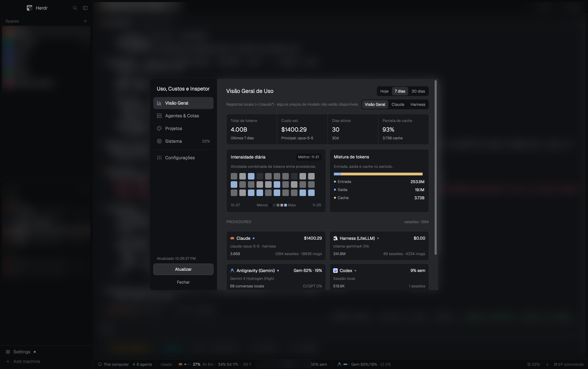

# Herdr Main Orca Layout (`main-orca`)

A community layout for [Herdr](https://herdr.dev) that keeps the native sidebar focused on Spaces and Agents while adding an Orca-inspired `28px` unified AI usage, quota, and system telemetry bottom bar via [`herdr-usage-meter`](https://github.com/goul4rt/herdr-usage-meter).



## What's Included

- `layouts/main-orca.json` — Non-intrusive extension of Herdr's `main` layout with a `28px` bottom `status` slot.
- `mods/usage-meter/` — Full bundled `usage-meter` mod (`main.js`, `i18n.js`, `collect.py`, `mod.json`, SVG icons) with multi-account Claude, LiteLLM/Gateway Harness, Antigravity (Gemini + Claude/GPT), Codex, OpenCode, project token analytics, system telemetry, and PT/EN/ES support.

> Looking for only the mod to drop into your own custom layout? See [`goul4rt/herdr-usage-meter`](https://github.com/goul4rt/herdr-usage-meter).

## Installation

1. Copy the layout and mod folders into your Herdr config directory (leave out `RECIPE.md` and `preview.png`):

   ```bash
   cp layouts/main-orca.json ~/.config/herdr-app/layouts/main-orca.json
   cp -R mods/usage-meter ~/.config/herdr-app/mods/usage-meter
   ```

2. Validate the mod and switch to the layout:

   ```bash
   herdr-app check ~/.config/herdr-app/mods/usage-meter
   herdr-app do layout.switch --name main-orca
   ```

   *(Use `Cmd+Shift+L` anytime to switch back to any other layout.)*

## Requirements

- **macOS** (`python3`, `curl`, Keychain `security`, `lsof`, `vm_stat`, `top`)

## License

MIT
