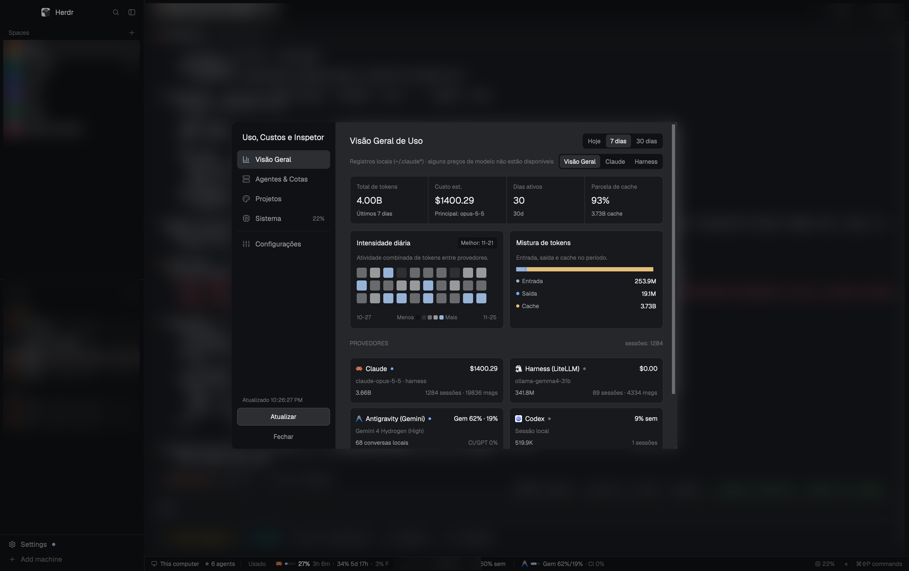

# Main Orca

Herdr's clean workspace layout (`main`) paired with an Orca-style `28px` unified bottom status bar powered by `usage-meter`: keeps the default `268px` left sidebar focused strictly on spaces, running agents, and settings, while moving all AI quota pills, token usage, cost estimates, quick popover drill-down, and system resource monitoring cleanly to the footer.

## What you see

- **Left sidebar (`268px`, `background: "chrome"`, non-resizable):**
  - Top `46px` window-drag header (`workspace-chrome`).
  - Vertical stack of `spaces` (`weight: 1`, `min: 90`) and `agents` (`weight: 1`, `min: 90`).
  - Bottom `69px` footer (`workspace-chrome` with `{ "footer": true }`) for settings and add-machine controls.
- **Right work column (`work`, non-resizable):**
  - Top `42px` draggable tab bar (`tabs`).
  - `work-body` (`padding: 8`, `gap: 8`) holding the active terminal/pane stack (`radius: 10`, `1px` `border` ring, `1px` `accent` focus ring, `30px` `pane` header) plus a toggleable `368px` right side panel (`files` and `changes`, `hidden: true` by default).
  - Bottom `28px` full-width `status` bar (`usage-meter` with `{ "mode": "status", "poller": true }`) displaying machine/agent count, collapsible provider pills (Claude profiles, LiteLLM/Gateway harnesses, Antigravity Gemini + Claude/GPT), optional CPU/USD badges, and the command palette shortcut.

## How it behaves

- Keeps the sidebar untouched relative to Herdr's native workspace experience (`cmd-b` toggles sidebar visibility; `44px` minimum width when collapsed).
- Renders a subtle `1px` `border` divider across panes and docks the `28px` `usage-meter` status bar across the bottom of the right work column.
- Clicking provider pills or the machine/agent block in the bottom bar opens the `400px` quick usage popover directly above the footer (with interactive drill-down into provider windows), or launches the `840x616` native `Uso, Custos e Inspetor` dialog.
- Starts with the status bar collapsed by default (`alwaysStartCollapsed: true`, `barCollapsed: true`) and refreshes usage/quotas silently in the background every 15 minutes (`collect.py`) while refreshing macOS CPU/ports every `120_000 ms`.

## Built from

- **Layout file:** `layouts/main-orca.json` (cloned from Herdr `main` `0.1.17`, `titlebar: "none"`, `traffic_lights: [12, 16]`, `background: "canvas"`, `terminal_padding: [14, 12]`, `divider: { width: 1, color: "border" }`).
- **Shipped mods used:** `workspace-chrome`, `spaces`, `agents`, `tabs`, `pane`, `files`, `changes`.
- **Custom mod included:** `mods/usage-meter/` (`mod.json`, `main.js`, `i18n.js`, `collect.py`, and monochrome UI SVGs) mounted in `"id": "status"` with `{ "mode": "status", "poller": true }`.

## Watch out

- Keep both `layouts/main-orca.json` and `mods/usage-meter/` in sync when copying to `~/.config/herdr-app/`.
- `collect.py` relies on macOS tools (`security find-generic-password`, `lsof`, `vm_stat`, `top`, `sysctl`) plus `python3` and `curl`.
- Never commit runtime files (`cost-cache.json`, `quota-cache.json`, `snapshot.json`) created inside `mods/usage-meter/` during execution.

## Done when

- `herdr-app check ~/.config/herdr-app/mods/usage-meter` passes cleanly.
- `herdr-app do layout.switch --name main-orca` loads with `"layout": "main-orca"` and `"errors": []` in `herdr-app status`.
- The left sidebar remains free of custom usage blocks while the `28px` bottom status bar renders live pills, opens the popover, and launches the `840x616` inspector dialog.
