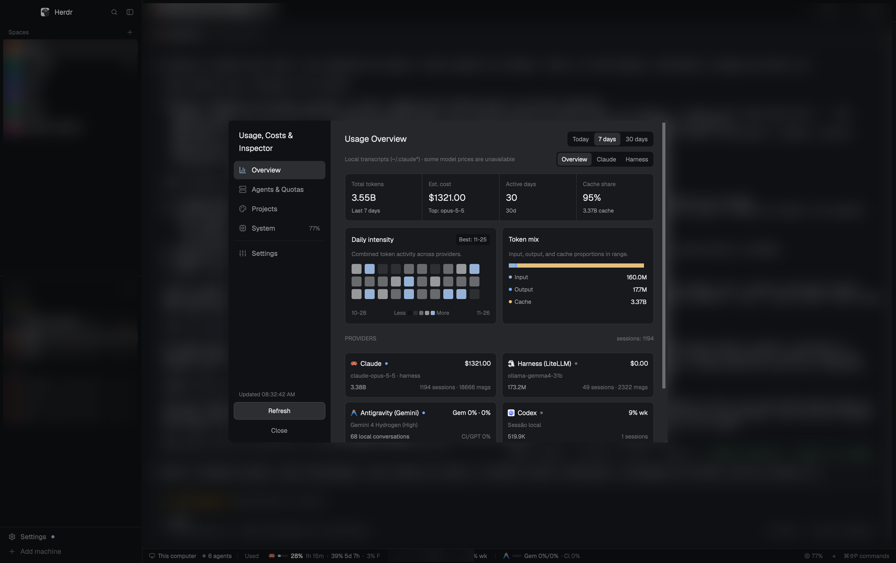

# CostUsage

A Herdr workspace layout (`costusage`) with an integrated `28px` bottom AI usage, quota, local token cost, and macOS system telemetry bar powered by `usage-meter`: keeps the native `268px` left sidebar focused strictly on spaces and agents, opens a `400px` quick drill-down popover above the footer, and launches an `840x616` native dialog inspector.

## What you see

- **Left sidebar (`268px`, `background: "chrome"`, non-resizable):** Top `46px` window-drag header (`workspace-chrome`), vertical stack of `spaces` (`weight: 1`, `min: 90`) and `agents` (`weight: 1`, `min: 90`), and a `69px` footer (`workspace-chrome` with `{ "footer": true }`).
- **Right work column (`work`, non-resizable):** Top `42px` draggable tab bar (`tabs`), `work-body` (`padding: 8`, `gap: 8`) with the active pane stack (`radius: 10`, `1px` `border` ring, `1px` `accent` focus ring, `30px` `pane` header) plus a toggleable `368px` right panel (`files` / `changes`, `hidden: true` by default), and a full-width `28px` bottom `status` bar (`usage-meter`).
- **Bottom status bar (`mode: "status"`, `28px`):** Displays live machine/agent counts (`{machine} • {n} agents`), optional `Used`/`Left` toggle chip, compact provider pills (`Claude` profiles, LiteLLM/Gateway harnesses, `Antigravity` `Gem X%/Y% · Cl Z%`), optional CPU/`$USD`/action icons, collapse chevron (`«` / `»`), and command palette hint.
- **Quick popover (`400px` overlay) & Inspector dialog (`840x616` overlay):** Click pills to expand quotas in-place (`Detailed | Compact`, `Used ↑↓ | Left ↓↑`), or inspect 35-day activity heatmaps, token mix, dynamic `PROVIDERS` grid (`Claude`, `Harness (LiteLLM)`, `Antigravity (Gemini)`, `Codex`, `OpenCode`, and extra CLIs), per-project local usage, listening TCP ports, and inline multi-account customization in English, Portuguese, and Spanish.

## How it behaves

- Keeps the left sidebar free of custom usage widgets (`cmd-b` toggles visibility; `44px` minimum collapsed width).
- Starts with the bottom status bar collapsed by default (`alwaysStartCollapsed: true`, `barCollapsed: true`) until expanded.
- Polls full usage/quota silently every `15m` by default (spinner animates only on manual refresh or initial empty cache; `5s` manual throttle) and refreshes lightweight macOS CPU/ports every `120_000 ms` (`collect.py sys`).
- Dedupes Claude Code JSONL entries by `message.id:requestId` with monotonic max token merging across `~/.claude*/projects` and subagent transcripts, keeping non-Anthropic / Harness models (`ollama-*`, `kiro-*`, etc.) at `$0.00`.

## Built from

- **Layout:** `layouts/costusage.json` (cloned from Herdr `main` `0.1.17`, `titlebar: "none"`, `traffic_lights: [12, 16]`, `background: "canvas"`, `terminal_padding: [14, 12]`, `divider: { width: 1, color: "border" }`), mounting `"mod": "usage-meter"` with `"props": { "mode": "status", "poller": true }` in `"id": "status"` (`{ "px": 28 }`).
- **Shipped mods used:** `workspace-chrome`, `spaces`, `agents`, `tabs`, `pane`, `files`, `changes`.
- **Bundled custom mod:** `mods/usage-meter/` (`mod.json`, `main.js`, `i18n.js`, `collect.py`, monochrome UI SVGs).

## Watch out

- Keep `layouts/costusage.json` and `mods/usage-meter/` synced in `~/.config/herdr-app/`.
- `collect.py` requires macOS tools (`security find-generic-password`, `top`, `vm_stat`, `sysctl`, `df`, `lsof`) alongside `python3` and `curl`.
- Never commit generated runtime files (`cost-cache.json`, `quota-cache.json`, `snapshot.json`) created inside `mods/usage-meter/`.

## Done when

- `herdr-app check ~/.config/herdr-app/mods/usage-meter` passes cleanly with zero errors.
- `herdr-app do layout.switch --name costusage` loads with `"layout": "costusage"` and `"errors": []` in `herdr-app status`.
- The bottom `28px` bar populates provider pills, opens the `400px` popover, and launches the `840x616` inspector dialog.
