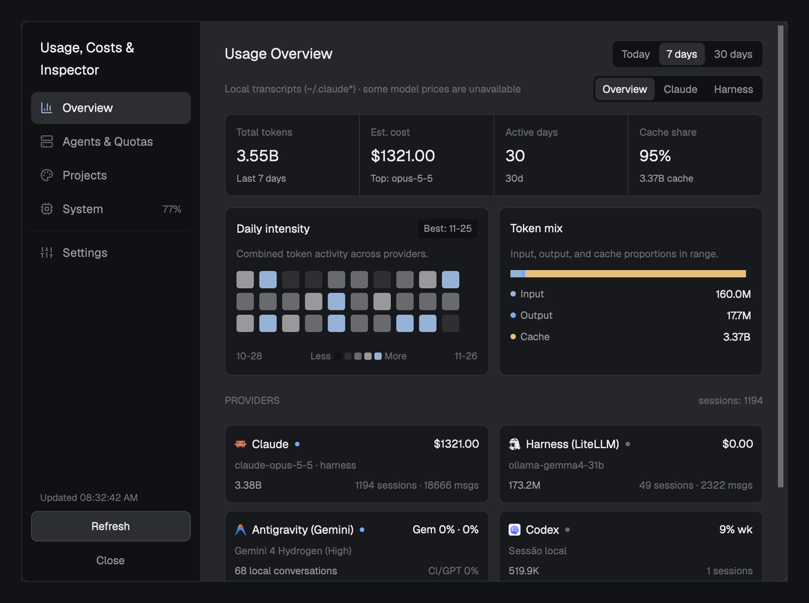

# Usage Meter

Unified AI agent usage, quota, local token cost, and macOS system telemetry mod for Herdr: mounts in any `28px` bottom status slot (or opens via command/key), renders a compact `400px` drill-down popover, and launches an `840x616` native dialog inspector across Claude Code profiles, LiteLLM/Gateway harnesses, Antigravity (Gemini + Claude/GPT), Codex, OpenCode, other detected CLIs, local projects, and listening ports in English, Portuguese, and Spanish.

## What you see

- **Status bar (`mode: "status"`, `28px` height):** Machine/agent count (`{machine} • {n} agents`), optional `Used`/`Left` toggle chip, compact provider pills (`Claude` accounts with custom alias/icon, LiteLLM/Gateway harnesses, `Antigravity` `Gem X%/Y% · Cl Z%`), optional CPU/`$USD`/action buttons, collapse chevron (`«` / `»`), and command palette hint.
- **Quick popover (`400px` overlay):** Refresh button, `Used ↑↓` / `Left ↓↑` sort toggle, `Detailed | Compact` segmented mode switch, expandable provider rows with in-place quota bar drill-down (`5h`, `Weekly`), optional `$USD` footer, and links into inspector tabs.
- **Inspector dialog (`840x616` overlay with `190px` navigation rail):**
  - **Overview:** Timeframe (`Today` / `7 days` / `30 days`) and scope (`Overview` / `Claude` / `Harness`) switches; unified 4-cell KPI strip(s) (`Total tokens`, `Est. cost`, `Active days`, `Cache share`; plus `Input`, `Output`, `Cache read`, `Cache write`, `Cache reuse`, `No cache read`, `Sessions / Turns`, `Est. cost`); 35-day activity intensity heatmap; token mix bar; dynamic 2-column `PROVIDERS` grid (`Claude`, `Harness (LiteLLM)`, `Antigravity (Gemini)`, `Codex`, `OpenCode`, and extra CLIs); 14-day daily chart; top models and projects.
  - **Agents & Quotas:** Full quota window cards and detected CLI/agent cards (`Gemini CLI`, `Kimi`, `Grok`, `Cursor`, `Codex`, `OpenCode`).
  - **Projects:** Local token, cache, session/turn counts, and optional `$USD` equivalents by project directory.
  - **System:** Live macOS CPU, RAM, disk summary, top processes, and local listening TCP ports (`lsof`).
  - **Settings:** Language (`Auto` / `Portuguese` / `English` / `Español`), percentage mode, default popover mode, optional `$USD` toggles, granular status-bar toggles (`alwaysStartCollapsed`, USD badge, action icons, CPU, ports), poll interval (`5m` / `15m` / `30m`), provider toggles, and a fixed-column `Detected Accounts` table with inline profile renaming (`Input`), 17-icon picker, `In bar`, and `Active` toggles.

## How it behaves

- Starts collapsed by default (`alwaysStartCollapsed: true`, `barCollapsed: true`) until clicked open.
- Polls full usage/quota silently every `15m` by default (spinner animates only on manual click or initial empty cache; `5s` manual throttle) and refreshes macOS CPU/ports every `120_000 ms` via `collect.py sys`.
- Handles `nextCommand()` commands (`popover`, `details`, `claude`, `all`, `agents`, `ports`, `settings`, `refresh`, `toggle_bar`, `toggle_sidebar`, `lang:<auto|pt|en|es>`), with optional `keys.json` shortcuts `alt-u` (`usage-meter.popover`) and `alt-shift-u` (`usage-meter.details`).
- Dedupes Claude Code JSONL entries by `message.id:requestId` with monotonic max token merging across `~/.claude*/projects` and subagent transcripts, keeping non-Anthropic / Harness models (`ollama-*`, `kiro-*`, etc.) at `$0.00`.

## Built from

- **Files:** `mods/usage-meter/mod.json` (`place: "none"`, `overlay: { kind: "dialog", width: 840, height: 616 }`), `mods/usage-meter/main.js`, `mods/usage-meter/i18n.js`, `mods/usage-meter/collect.py`, monochrome SVGs (`arrows-up-down.svg`, `chart.svg`, `chevron-down.svg`, `chevron-right.svg`, `cpu.svg`, `ports.svg`, `refresh.svg`, `sliders.svg`), and optional `keys.json`.
- **Herdr APIs:** `exec`, `shared` / `setShared`, `openOverlay` / `closeOverlay`, `nextCommand`, `theme`, `hosts`, `agents`, `spaces`, `tabs`, `run`, `appHome`, and `gpui-kit` components (`v_flex`, `h_flex`, `div`, `label`, `button`, `switch`, `Input`, `Scrollbar`, `svg`, `image`).
- **Props:** `{ "mode": "status", "poller": true }` in any `28px` status block.

## Watch out

- **macOS dependency in `collect.py`:** Uses macOS Keychain (`security find-generic-password`), `top -l 1`, `vm_stat`, `sysctl`, `df -k`, and `lsof -iTCP -sTCP:LISTEN -n -P`, plus `python3` and `curl`. Linux setups need `/proc` + Secret Service fallbacks.
- **Runtime caches stay local:** `collect.py` creates `cost-cache.json`, `quota-cache.json`, and `snapshot.json` inside `mods/usage-meter/` (`OAUTH_MIN_TTL_MS = 180_000` with `429` fallback to `lastOk`). Never commit those files.
- **Key merges:** Optional `keys.json` adds `alt-u` and `alt-shift-u` under `"global"`; check existing bindings in `~/.config/herdr-app/keys.json` before merging.

## Done when

- `herdr-app check ~/.config/herdr-app/mods/usage-meter` passes cleanly with zero errors.
- Mounted in a `28px` status block with `{ "mode": "status", "poller": true }`, the bar populates live provider pills, `herdr-app do usage-meter.popover` toggles the popover, and `herdr-app do usage-meter.details` opens the `840x616` inspector dialog.
